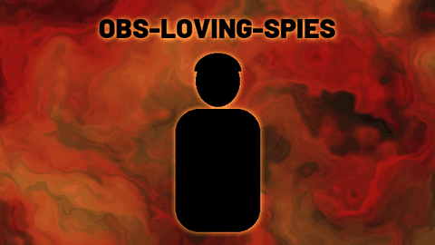

# obs-loving-spies

*Gun-barrel intro, blood drip and silhouette titles for OBS.*

Shaders para **OBS Studio** inspirados en las intros clásicas de películas de espías: la toma a través del cañón de una pistola, la sangre que escurre desde arriba y los créditos con siluetas sobre tinta líquida.

*[English below](#english)*

Las animaciones de este README son simulaciones aproximadas de los shaders con una figura de ejemplo; en OBS algunos detalles varían. / The animations are approximate simulations of the shaders.

## Requisitos

- OBS Studio
- Plugin [obs-shaderfilter](https://github.com/exeldro/obs-shaderfilter)

## Shaders

| Archivo | Qué hace |
|---|---|
| `canon.shader` | La secuencia completa del cañón: un punto blanco cruza la pantalla dejando sombras, se abre y deja ver la fuente dentro del cañón estriado, que se desliza al centro, escurre sangre, la boca se cierra y al final se abre a pantalla completa. |
| `sangre.shader` | Solo la cortina de sangre: chorros que crecen cada uno a su ritmo con gota en la punta, orilla que ondula y gotas que caen. Sirve como transición sobre cualquier fuente; puede quedarse cubriendo o escurrir y salir por abajo. |
| `titulos.shader` | Fondo de tinta líquida (negro, rojo y dorado) con la fuente convertida en silueta, resplandor en el contorno y caleidoscopio opcional. |

## Instalación

1. Descarga los archivos `.shader` (o clona el repo).
2. En OBS, clic derecho sobre la fuente o escena → **Filtros** → **+** → **User-defined shader**.
3. Activa **Load shader text from file** y elige el archivo `.shader`.
4. Ajusta los parámetros.

## Cañón (`canon.shader`)

Aplícalo a la fuente que debe verse dentro del cañón (tu cámara o la escena completa). Si la fuente tiene transparencia, por ejemplo una cámara con quitado de fondo, dentro de la boca se ve sobre blanco como en el clásico; el color se cambia en **inner_bg**.

| Progreso | Qué pasa |
|---|---|
| 0–24 % | Un punto blanco, del tamaño de la boca cerrada, cruza la pantalla de izquierda a derecha. Va dejando sombras fijas iguales a él; cada una se apaga en 50 ms cuando deja la siguiente |
| 24–32 % | Al tocar la orilla derecha, la última sombra se apaga y el punto se ensancha hasta el Radio de la boca: adentro la fuente, afuera el cañón |
| 30–55 % | El cañón se desliza hasta el centro, como si siguiera a la fuente |
| 32–60 % | El cañón gira y se bambolea |
| 60–76 % | Escurre la sangre |
| 76–88 % | El cañón cae y tiembla; la boca se cierra |
| 88–97 % | El círculo se abre a pantalla completa (o funde a negro) |

| Parámetro | Efecto |
|---|---|
| Reproducir en bucle | Repite la secuencia sola. Apágalo para controlar el Progreso a mano o con el script |
| Duración | Segundos que dura la secuencia completa |
| Centro X/Y, Radio de la boca | A dónde llega la boca del cañón y qué tan grande es |
| Tamaño del punto y de la boca cerrada | Un solo control para los dos: el punto del inicio y el círculo al que se cierra la boca después de la sangre, en % del Radio de la boca (40 por defecto) |
| Punto blanco / Sombras del punto | El punto que cruza al inicio y cuántas sombras deja, repartidas a lo ancho (0 = ninguna) |
| Estrías / Torsión / Giro | Número de estrías, cuánto se tuercen en espiral y velocidad de giro |
| Profundidad | Contraste de los anillos de maquinado y oscurecimiento hacia la orilla |
| Bamboleo | Cuánto se mueve el cañón como si siguiera a alguien |
| Sangre / Opacidad / Largo / Ancho de los chorros | La cortina roja de la mitad de la secuencia. Con opacidad menor a 1 la fuente se transparenta a través de la sangre. El ancho cambia el grosor de los chorros y las gotas (y qué tan separados están) |
| Movimiento de la sangre | Qué tanto ondula, se arrastra y gotea (0 = quieta) |
| Fusión de la sangre | Cómo se mezcla la sangre con lo que hay debajo, como en Photoshop (ver abajo) |

## Sangre (`sangre.shader`)

Con <b>Escurrir al final</b> activado.

| Parámetro | Efecto |
|---|---|
| Duración / Progreso | Igual que en el cañón |
| Opacidad | 1 tapa la fuente por completo; con menos, se transparenta |
| Largo / Ancho de los chorros | Qué tanto se adelantan los chorros al resto y qué tan gruesos son |
| Variación (semilla) | Cambia el dibujo de los chorros |
| Movimiento | Qué tanto ondula la orilla, se arrastran las puntas y caen gotas sueltas (0 = quieta). Sigue vivo aunque detengas el Progreso |
| Escurrir al final | La sangre sigue bajando y sale por abajo, dejando la fuente limpia |
| Fusión de la sangre | Cómo se mezcla la sangre con la fuente (ver abajo) |

### Fusión de la sangre

Los dos shaders tienen los mismos métodos de fusión, con las fórmulas de Photoshop:

| Modo | Cómo se ve |
|---|---|
| Normal | Sangre sólida que tapa lo de abajo |
| Multiplicar | Mancha translúcida: lo claro se tiñe de rojo, lo oscuro casi no cambia |
| Oscurecer | Parecido a Multiplicar, pero solo oscurece donde la sangre es más oscura |
| Subexponer color | Muy contrastado: lo claro queda rojo intenso, el resto casi negro |
| Superponer / Luz suave | Tinte rojizo suave que respeta luces y sombras |
| Luz fuerte | Como Normal en las sombras, pero las zonas claras quedan rojo vivo |
| Color | Pinta de rojo conservando la luz de la fuente |
| Trama (Screen) | Solo aclara: un brillo rojizo que se nota en lo oscuro y desaparece en lo claro. Con un color de sangre más claro se ve más |

## Títulos con siluetas (`titulos.shader`)

La silueta sale de la **transparencia** de la fuente: funciona mejor con una cámara con quitado de fondo, chroma key o un PNG. Si tu fuente no tiene transparencia, activa **Silueta por brillo** y ajusta el umbral.

| Parámetro | Efecto |
|---|---|
| Colores (dark / gold / red) | Paleta de la tinta líquida |
| Escala / Velocidad del fondo | Tamaño y velocidad de los remolinos |
| Caleidoscopio | Número de gajos espejados (0 = apagado) y su giro |
| Relleno de silueta | 0 = color sólido; 1 = el fondo en negativo dentro de la figura |
| Resplandor del contorno | Brillo dorado alrededor de la silueta |
| Mezcla con la fuente original | Deja ver la imagen real por encima del efecto |

## Disparar la intro con un hotkey (script)

Por sí solo, el shader solo puede correr en bucle porque no sabe cuándo "empieza" la intro. `intro-control.lua` apaga el bucle y mueve el Progreso de 0 a 100 en la duración del filtro.

1. **Herramientas → Scripts → +** y elige `intro-control.lua`.
2. En **Filtro de intro** elige tu filtro de cañón o sangre (si no aparece, **Actualizar lista**).
3. Presiona **Reproducir**, o asigna un atajo en **Configuración → Atajos de teclado → Reproducir intro (obs-loving-spies)**.

No está afiliado ni respaldado por ninguna franquicia de cine.

---

## English

Shaders for **OBS Studio** inspired by classic spy-film intros: the gun-barrel shot, blood dripping down from the top, and silhouette title credits over liquid ink.

### Requirements

- OBS Studio
- [obs-shaderfilter](https://github.com/exeldro/obs-shaderfilter) plugin

### Shaders

| File | What it does |
|---|---|
| `canon.shader` | Full gun-barrel sequence: a white dot slides across the black screen leaving a trail, opens into the rifled barrel with your source inside, glides to the center, blood drips down, the aperture closes and finally opens to full screen. |
| `sangre.shader` | Blood curtain with irregular drips. Works as a transition over any source; it can stay covering or drain out the bottom. |
| `titulos.shader` | Liquid-ink background (black, red and gold) with your source turned into a silhouette, edge glow and optional kaleidoscope. |

The blood in both `canon.shader` and `sangre.shader` has Photoshop-style blend modes (*Fusión de la sangre*): normal, multiply, darken, color burn, overlay, soft light, hard light, color and screen.

Parameter labels are in Spanish. Add the filter with **User-defined shader → Load shader text from file**. For the silhouette shader, the source needs transparency (background removal, chroma key or PNG), or enable *Silueta por brillo* to key on brightness.

To trigger the gun-barrel or blood sequence once with a hotkey, load `intro-control.lua` (**Tools → Scripts**), pick the filter and press *Reproducir*, or bind *Reproducir intro (obs-loving-spies)* under **Settings → Hotkeys**.

Not affiliated with or endorsed by any film franchise.

## License

MIT
